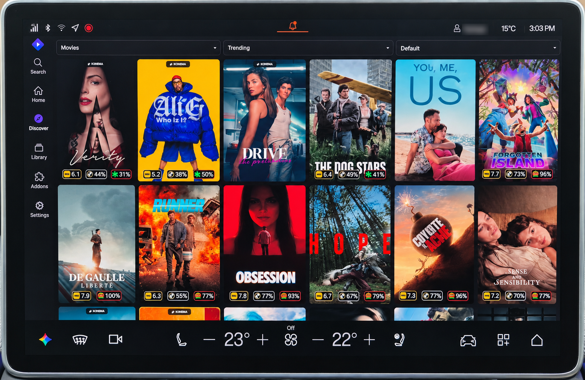
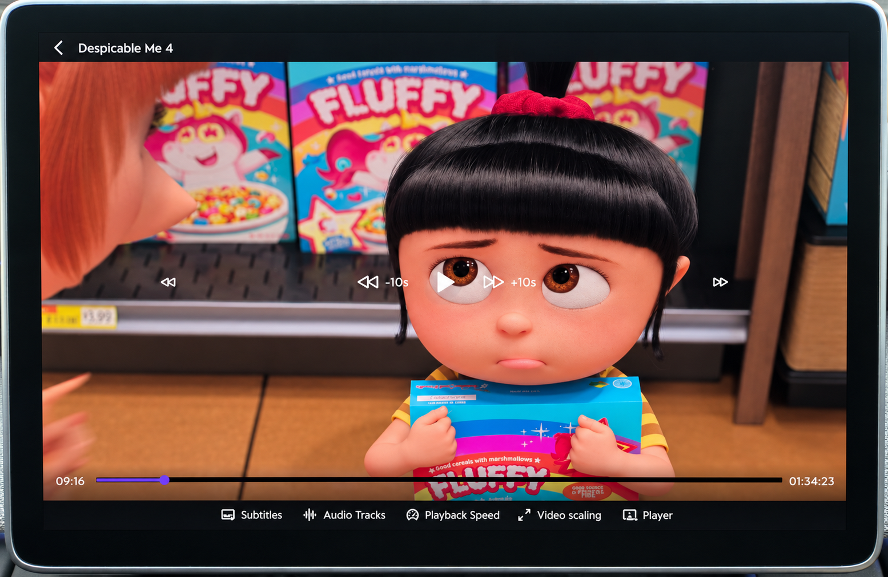

# Stremio for Android Automotive OS (AAOS)

A modified build of Stremio for mobile v2.5.0 (`com.stremio.one`) adapted for horizontal Android Automotive OS screens. Tested on the 15.4" Polestar 4 display (1920x1200), but works on other landscape AAOS screens.

The stock mobile Stremio APK is built for phones. On a wide car display:
- It crams 14 tiny posters across a row, or cuts them in half at the right edge
- Settings are squished into a narrow strip on the left, leaving three-quarters of the screen empty
- The video player HUD disappears after 3 seconds and hides the bottom controls

This build patches the layout so it actually fits the screen.

### What's changed
- Clean 6-poster shelves across Home, Discover, and Search with readable ratings and no cut-off edges
- Wider 140dp sidebar with bigger icons and text you can tap from the seat
- Video player controls stay on screen while parked, with dedicated +/-10s skip buttons and large action buttons
- Settings and addon pages stretch across the full width with big touch targets
- Top filter chips moved down so the car status bar does not clip them
- Removed mobile screen rotation; fixed video scaling toggle (Fit, Crop, Stretch, Original)

### Install
Download `com.stremio.one-2.5.0.1-AAOS.apk` from [Releases](https://github.com/ai-obsessed/Stremio-for-AAOS/releases).

1. Open the car browser (Vivaldi), download the APK, and tap install.
2. Allow installation from unknown sources if prompted. You can also install it via USB drive.

---
*For parked use only (charging stops, waiting in the car).*  
*Independent community mod. Stremio is a trademark of SmartCode OOD and is not affiliated with this project.*
